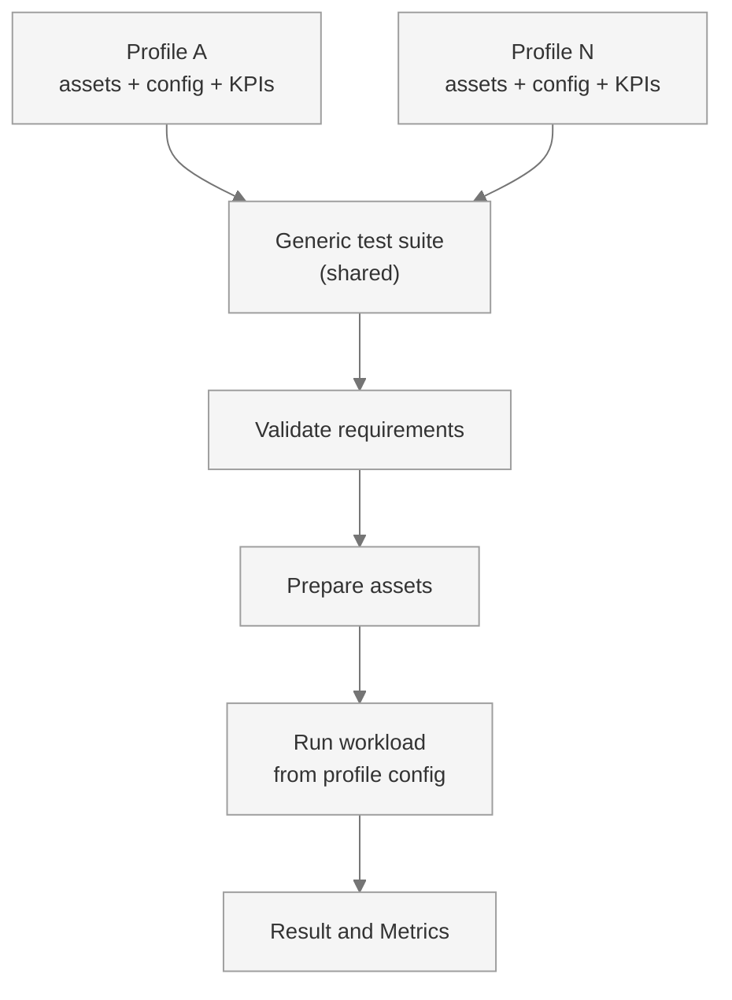
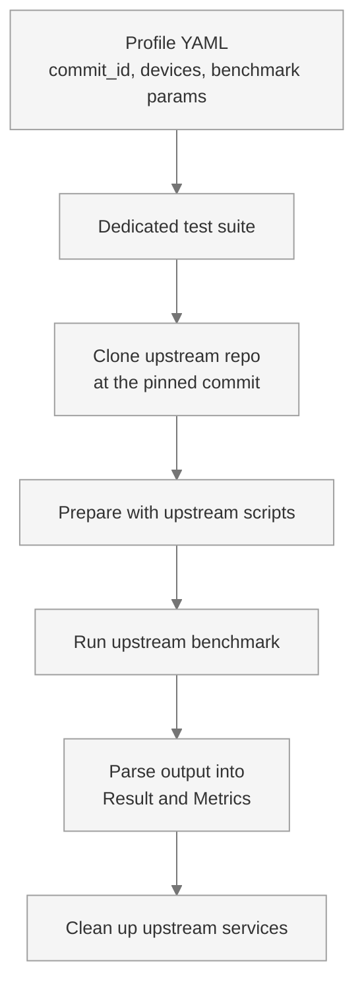
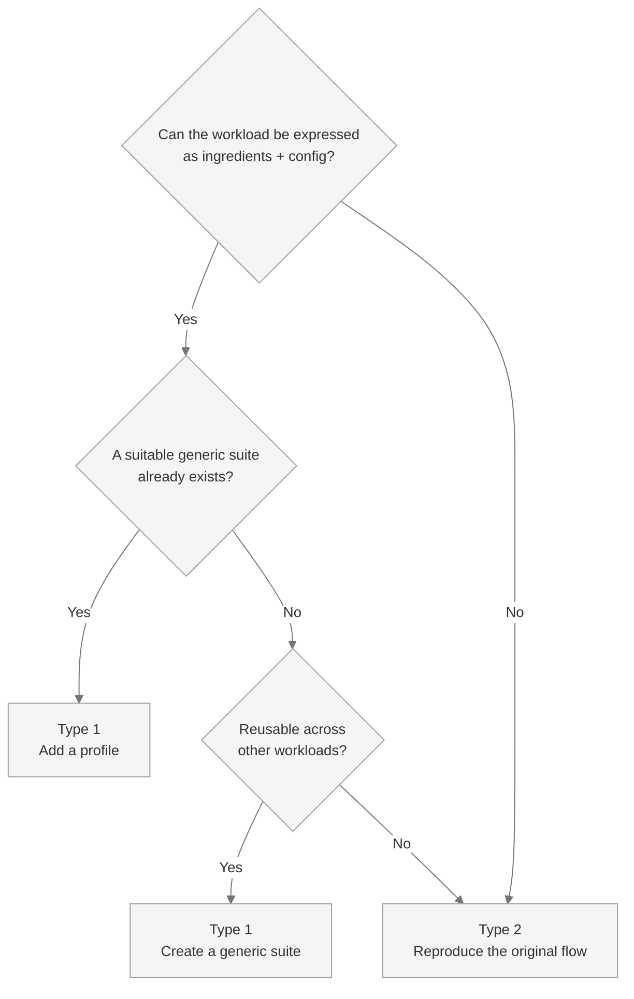

# Integration Types

There are two ways to integrate an external benchmark or application into Intel® ESQ. Both produce the same outputs (`Result`, `Metrics`, Allure report) and follow the same [execution pattern](writing-tests.md). They differ in **where the workload is defined**.

| | Type 1: Generic suite | Type 2: Reproduce the original flow |
|---|---|---|
| **Workload defined in** | Profile YAML (assets, configuration, parameters) | Dedicated test suite (Python) |
| **Test suite** | One suite shared by many profiles | One suite per workload |
| **Upstream source** | Only the key ingredients are extracted | Cloned and run as-is, pinned to a release |
| **Role** | Baseline: only the benchmark components run | Application result: baseline plus the cost of the other services |
| **Examples** | [DL Streamer](../../suites/ai/dlstreamer.md), [VLM Prompt](../../suites/ai/vlm-prompt.md) | [Order Accuracy](../../suites/vertical/order-accuracy.md) |

The page of each test suite in [Test Suites](../../suites/index.md) states its type. Tests that check the system itself, such as CPU or network checks, are also Type 1: one generic suite, configured by the profile.

---

## Type 1: Generic Suite with Configurable Ingredients

A generic suite is written once and takes its ingredients from the profile: assets, pipeline or prompt, model, devices, and KPIs. Adding a workload means writing a profile, not a new suite.

A generic suite is a **baseline**. It runs only the main benchmark components, so it shows what the system delivers for the workload. The application (Type 2) runs the same workload with its other services and adds overhead. Comparing the two shows the cost of the application.

Guidelines:

- **Keep the suite generic.** Read the model, media, pipeline, or prompt from `configs`, never hard-code them.
- **Take ingredients from what the application actually sends**, not from its documentation, and from its official release.
- **Declare assets with a pinned URL and `sha256`.** See [Asset Management](assets.md).
- **Extend the suite, not the application.** Add optional parameters and keep existing profiles working.
- **Reuse shared infrastructure**, such as the OVMS export and server helpers, and prefer a `uv` venv over a container for Python-only tools.
- **Verify comparability** against the application before relying on the numbers. The [VLM Prompt](../../suites/ai/vlm-prompt.md#comparison-with-the-upstream-benchmarks) page shows a worked comparison.

---

## Type 2: Reproduce the Original Flow

The suite repeats the steps of the original benchmark, including cloning the upstream repository. Use it when the workload cannot be reduced to ingredients, or when results must match the upstream benchmark exactly.

Guidelines:

- **Pin a stable release tag**, not `main`, and expose it as a profile parameter (for example `commit_id`).
- **Reuse the upstream entry points** (scripts, `make` targets) instead of re-implementing them.
- **Clone once and always clean up** the upstream services, also on interruption.
- **Attach upstream logs** to the Allure report and convert the upstream results into `Metrics`.
- **Check host ports.** Upstream compose files bind fixed ports that can collide with ESQ or other services.

---

## Choosing an Approach

| Consideration | Type 1: Generic suite | Type 2: Reproduce original flow |
|---------------|-----------------------|---------------------------------|
| Depends on | Assets, models, prompts, and config | The complete upstream application |
| Release | Not tied to an application release | Pin a stable release tag |
| Stability | High, one suite exercised by many profiles | Depends on the upstream release |
| Maintenance | One suite, many profiles | One suite per workload |
| Fidelity | Same requests, without the rest of the application | Highest, runs the original flow |
| Services on the system | Only the key components | Every service of the application |
| Typical fit | Model, pipeline, and prompt-based benchmarks | Multi-container apps, custom orchestration |

Group workloads by kind, not by application. For example, vision pipelines of several Retail AI Suite apps fit `test_dlstreamer`, while their VLM workloads fit `test_vlm_prompt`.
