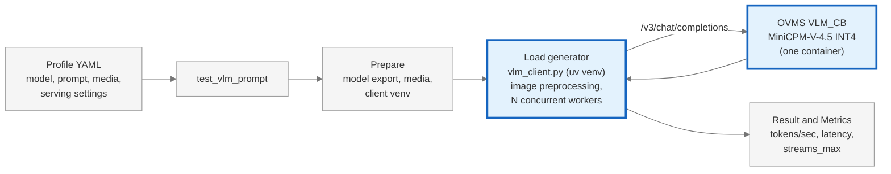
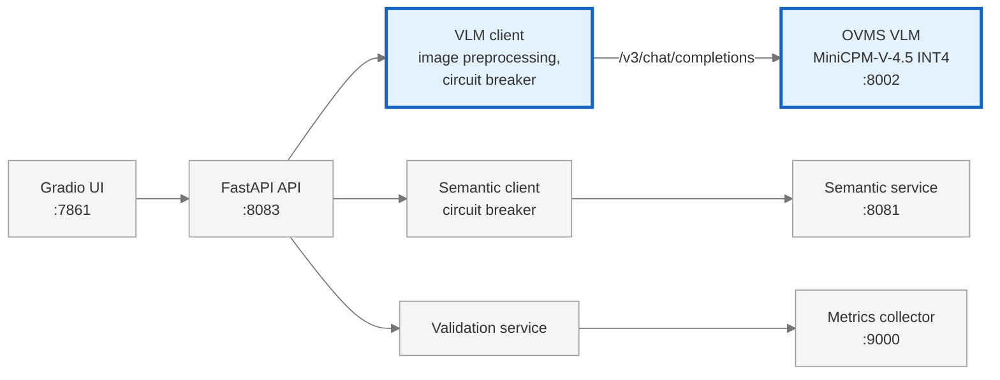
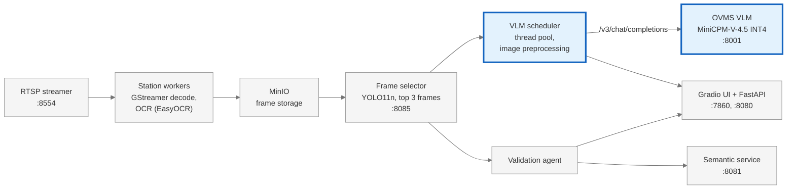

# VLM Prompt

Sends prompts with images or video frames to a vision language model (VLM) on OpenVINO™ Model Server (OVMS) and measures token throughput, request latency, and how many requests the device can serve at the same time within a latency target.

| | |
|---|---|
| **Test suite** | `test_vlm_prompt` (`src/esq/suites/ai/gen/test_vlm_prompt.py`) |
| **Integration type** | [Type 1: generic suite](../../guides/developer/integration-types.md#type-1-generic-suite-with-configurable-ingredients). The model, prompt, and media come from the profile. |
| **Key metric** | Fixed load: `output_token_throughput` (tokens/sec). Stream density: `streams_max` (streams). Both per device, for example `output_token_throughput_igpu` or `streams_max_dgpu1`. |
| **Devices** | CPU, iGPU, dGPU. A category that matches several devices (two dGPUs) runs once on each. |

It is the baseline of the Order Accuracy applications: only the model server and a load generator run, without the application's other services. The [Order Accuracy](../vertical/order-accuracy.md) suites (Type 2) run the full applications.

## How It Works

1. Export the model with the OVMS export flow of the text generation suite (or download a pre-quantized model), write the serving graph, and download the `media`.
2. Start one OVMS container on the device.
3. Run the load generator (`src/vlm_prompt/vlm_client.py`) in its own `uv` venv. It sends chat-completion requests from concurrent workers and records latency and token usage of every request.
4. Report the results:
    - **Fixed load** (`benchmark_mode: fixed_workers`): `benchmark_workers` run for `benchmark_duration`. Requests started during `benchmark_init_duration` are left out.
    - **Stream density** (`benchmark_mode: stream_density`): adds concurrent requests until the latency exceeds `target_latency_ms` and reports the largest count that passed. The count is searched with the latency-guided search of `test_dlstreamer` (`density_search: adaptive`) or one step at a time (`linear`).

## Metrics

Per device, with the device as suffix (`_cpu`, `_igpu`, `_dgpu1`):

| Metric | Unit | Meaning |
|--------|------|---------|
| `output_token_throughput` | tokens/sec | Standard aggregate throughput of the system: the generated tokens of all measured requests, from all concurrent workers, divided by the measurement window from the start of the first request to the end of the last (key metric of fixed load) |
| `request_latency_avg` | sec | Mean duration of a full request |
| `streams_max` | streams | Stream density: most concurrent requests within the target (key metric of stream density) |
| `time_to_first_token_cold_start` | sec | Time to first token of the first request after the model server starts |
| `time_to_first_token_warm_start` | sec | Mean time to first token of the following requests |

`output_token_throughput` is a system-level value over many requests, not the rate of one request. With one worker it is the rate of requests that follow each other. With several workers it adds up their tokens, so it grows with the concurrency until the device is saturated. It is not the mean of the per-request rates, which is the `throughput_mean_sec` of the Order Accuracy applications, see [Metric Naming](#metric-naming).

The metadata of the result also has `request_count`, `measurement_window_sec`, `input_sequence_length_avg`, `output_sequence_length_avg` (in tokens), and `throughput_mean_sec`, see below.

### Metric Naming

The names follow the LLM serving metrics of NVIDIA [GenAI-Perf and AIPerf](https://docs.nvidia.com/aiperf/reference/ai-perf-metrics-reference) and the [OpenTelemetry GenAI semantic conventions](https://github.com/open-telemetry/semantic-conventions-genai/blob/main/docs/gen-ai/gen-ai-metrics.md), written in snake case with `sec` for seconds. The suite does not use the names of the Order Accuracy applications, so it can serve other workloads.

| ESQ metric | AIPerf, GenAI-Perf | OpenTelemetry GenAI | Take-Away and Dine-In applications |
|------------|--------------------|---------------------|------------------------------------|
| `request_latency_avg` | `request_latency` (mean) | `gen_ai.client.inference.duration` | `vlm_avg_call_duration` of `test_ta_vlm` and `test_di_vlm`, `VLM_AVERAGE_CALL_DURATION` in `consolidated_metrics.csv`, `elapsed_sec` of the `ovms_vlm_request` event |
| `output_token_throughput` | `output_token_throughput` (same definition, aggregate of all concurrent requests) | None | None. The closest is `throughput_mean_sec`, which is a per-request mean, see the note below |
| `time_to_first_token_cold_start`, `time_to_first_token_warm_start` | `time_to_first_token` | `gen_ai.server.time_to_first_token` | Not reported |
| `input_sequence_length_avg`, `output_sequence_length_avg` | `input_sequence_length`, `output_sequence_length` | `gen_ai.client.inference.operation.input_tokens`, `...output_tokens` | `prompt_tokens`, `completion_tokens` of the `ovms_vlm_request` event, `generated_tokens` |
| `streams_max` | None | None | Result of `make benchmark-stream-density` |

`throughput_mean_sec` of the applications is the mean over the requests of the generated tokens divided by the request latency. It has no standard name, and it is not the standard output token throughput, which divides all generated tokens by the measurement window and so also counts the time between requests. The two are equal when requests follow each other without a gap, and differ by the time the client needs to prepare a request (0.3% for Dine-In, 7.6% for Take-Away, which prepares 3 video frames per request on the CPU). The suite keeps the application value as `throughput_mean_sec` in the metadata, and the [comparison](#comparison-with-the-upstream-benchmarks) uses it. The applications have no time per output token in the standard sense: their `tpot_sec` is the request latency divided by the generated tokens, which includes the time to first token.

The time to first token follows the name and unit of `gen_ai.server.time_to_first_token` in the [OpenTelemetry GenAI semantic conventions](https://github.com/open-telemetry/semantic-conventions-genai/blob/main/docs/gen-ai/gen-ai-metrics.md), called TTFT in MLPerf Inference. It covers the time in the queue and the prefill of the prompt and images. It is measured by a short probe of `ttft_requests` streaming requests, one after another, right after the server starts and before any other request. The benchmark requests stay non-streaming like the source applications, so the throughput and latency are unchanged. The cold start is the first request, which pays for the lazy initialization of the model, and the warm start is the mean of the others. Requests repeat the same prompt and media, so the warm start benefits from prefix caching like the benchmark requests do. With `restart_server_per_iteration` the probe runs only after the first start.

## Parameters

| Parameter | Default | Description |
|-----------|---------|-------------|
| `model_id` | required | Hugging Face model ID |
| `model_precision`, `quantization_params` | unset | Export and quantize `model_id` (for example `int4`). Unset means `model_id` is a pre-quantized OpenVINO model. |
| `ovms_container_image` | `openvino/model_server:2026.3.1-gpu` | Model server image |
| `cache_size`, `max_num_seqs`, `max_num_batched_tokens`, `enable_prefix_caching`, `plugin_config` | `4`, `4`, `8192`, `true`, `{}` | Serving graph settings (`VLM_CB` pipeline) |
| `rest_workers`, `max_rest_workers` | unset, unset | OVMS REST worker threads. Unset uses the OVMS default of one per CPU core. `max_rest_workers` caps it on systems with many cores, see [REST Workers](#rest-workers-and-max_num_seqs). |
| `system_prompt`, `prompt`, `prompt_params` | required `prompt` | Prompt text. `${NAME}` is filled from `prompt_params`, `${NUM_FRAMES}` with the number of images in the request. |
| `media` | required | Images or videos, each with `url`, `name`, and `sha256` |
| `images_per_request` | `3` | Images (or video frames, sampled evenly) per request |
| `image_max_size`, `jpeg_quality`, `image_preprocessing` | `448`, `82`, `{}` | Square canvas size, JPEG quality, and enhancement (`contrast`, `color`, `sharpen_percent`, `min_size`, `progressive`, `enhance_after_padding`) |
| `max_new_tokens`, `temperature` | `100`, `0.2` | Generation settings |
| `enable_thinking`, `response_format` | unset | Sent only when set: `chat_template_kwargs` and structured output (JSON schema) |
| `benchmark_mode` | `fixed_workers` | `fixed_workers` or `stream_density` |
| `benchmark_workers`, `benchmark_duration`, `benchmark_init_duration` | `1`, `200`, `10` | Fixed load: workers, measured seconds, warm-up seconds |
| `target_latency_ms`, `latency_metric` | `10000`, `avg` | Stream density target (`avg`, `p95`, or `max`) |
| `density_search`, `density_increment`, `max_workers` | `adaptive`, `1`, `50` | Stream density search, step size, and most workers tested. A result equal to `max_workers` is reported as `Worker Limit: ... (reached)`. |
| `requests_per_worker`, `min_requests`, `request_timeout` | `1`, `3`, `360` | Stream density: requests per worker per step, minimum requests, request timeout |
| `ttft_requests` | `4` | Streaming requests of the time to first token probe: 1 cold start and the rest warm start. `0` turns it off. |
| `warmup`, `restart_server_per_iteration` | unset, `false` | Stream density: one small request before the first step, or a server restart before every step (cold model) |

## Ingredients of the Order Accuracy Profiles

The profiles take their ingredients from the official OEP release `2026.2.1`, whose `edge-ai-suites` tag pins `retail-ai-suite/order-accuracy` at `v2026.2.0` (commit `70734ba2`). Benchmark settings follow the `main` branch of `intel-retail/order-accuracy`, which only changes the target latency (10 s instead of 25 s).

| Ingredient | Take-Away (`retail-oa-ta.yml`) | Dine-In (`retail-oa-di.yml`) |
|------------|--------------------------------|------------------------------|
| Model | `openbmb/MiniCPM-V-4_5`, INT4 asymmetric, group size 128 (as `setup_models.sh`) | Same, shared export |
| Serving | OVMS `2026.3.1-gpu`, `VLM_CB`, cache 4 GB, 4 sequences, 8192 batched tokens | Same |
| Prompt | Order-aware prompt with inventory and expected items, plus system prompt | Generic template with inventory, JSON `response_format`, no system prompt |
| Media | Sample video, 3 frames per request | 4 plate images, 1 per request |
| Generation | 100 tokens, temperature 0.2, thinking disabled | 96 tokens, temperature 0.0 |
| Fixed load | 1 worker, 10 s warm-up, 200 s | 1 worker, 60 s warm-up, 180 s |

The rendered prompts and `response_format` are identical to what the applications send, and the preprocessed images are identical byte for byte.

## Architecture Comparison With the Upstream Applications

The suite keeps the components that decide the VLM result (the model server, the model, the prompt, and the image preprocessing) and replaces the rest of the application with a load generator. Diagrams follow the [upstream architecture diagrams](https://github.com/intel-retail/order-accuracy/blob/main/docs/user-guide/oa-how-it-works.md#architecture-diagrams). Components with a dark border run in both; the others run only in the application.

### VLM Prompt Suite (Type 1)



### Dine-In Application (Type 2)



### Take-Away Application (Type 2)



### Components

| Function | Take-Away application | Dine-In application | VLM Prompt suite |
|----------|-----------------------|---------------------|------------------|
| VLM serving | `ovms-vlm`, OVMS with MiniCPM-V-4.5 INT4 | `dinein_ovms_vlm`, same | One OVMS container, same model, image, and `VLM_CB` settings |
| Model export | `setup_models.sh` | Shared with Take-Away | OVMS export flow of the text generation suite, same quantization |
| Request source | Station workers and VLM scheduler (thread pool, staggered stations) | FastAPI API, one request per image | Load generator workers, requests back to back |
| Image preprocessing | Frame selector output, resized and encoded in the scheduler | Orient, resize, enhance, JPEG 82% in the VLM client | Same operations in `vlm_client.py`, same bytes |
| Prompt | Order-aware prompt with inventory and expected items | Template with inventory and JSON `response_format` | Same text, from the profile |
| Video capture and decode | RTSP streamer, GStreamer | Not used (images) | Frames sampled from the media file |
| Frame selection | YOLO11n frame selector, MinIO storage | Not used | Not used, frames are sampled evenly |
| OCR and validation | EasyOCR, validation agent | Validation service | Not run |
| Semantic matching | Semantic service (`:8081`) | Semantic service (`:8081`) | Not run |
| User interface and API | Gradio and FastAPI | Gradio and FastAPI | None |
| Metrics | Application metrics logs | Metrics collector | `Metrics` and the Allure report |
| Resilience | Circuit breaker, RTSP probe | Circuit breakers | Request timeout and per-device failure reporting |
| Containers | 6 | 4 | 1 |
| Stream density | `make benchmark-stream-density`, restarts the stack per step | Same | Search with `density_search`, optional server restart per step |

What this means for the numbers: the suite measures the VLM path alone. Anything the application runs between requests (decoding, frame selection, OCR, semantic matching, the UI) appears only in the application result, which is why the Take-Away application is slower on the CPU and why [Dine-In matches within 3%](#comparison-with-the-upstream-benchmarks).

## Comparison With the Upstream Benchmarks

Measured on Intel® Core™ Ultra 9 285K with Intel® Arc™ Pro B70 (`GPU.1`), against the full applications (`test_ta_vlm`, `test_di_vlm`, and the upstream `make benchmark-stream-density`). Both send the same requests to the same model: 288 prompt and 15 completion tokens for Take-Away, 204 prompt tokens and the same answer per image for Dine-In.

**Fixed load, warm requests (`request_latency_avg`, `throughput_mean_sec` per request):**

| Device | Take-Away app | Take-Away baseline | Dine-In app | Dine-In baseline |
|--------|---------------|--------------------|-------------|------------------|
| CPU | 5.04 s, 2.99 | 4.46 s, 3.36 (−11%) | 3.10 s, 8.84 | 3.05 s, 8.95 (−1.6%) |
| iGPU | 5.54 s, 2.71 | 5.42 s, 2.78 (−2%) | 3.17 s, 8.63 | 3.16 s, 8.66 (−0.4%) |
| dGPU | 0.375 s, 41.07 | 0.294 s, 50.81 (−22%) | 0.400 s, 68.52 | 0.388 s, 70.64 (−3.1%) |

The percentage is the latency of the baseline relative to the application, so a negative value means the baseline is faster. The Dine-In figures are from a later run than the Take-Away figures. The Dine-In application sends only 8 requests (the 4 images twice), so its warm value is the mean of the second pass of 4 requests. The baseline value is the mean of all requests after its warm-up. A single application run varies by a few percent: a first CPU run gave 3.66 s where the repeat gave 3.10 s.

**Stream density, largest count within 10 s average latency:**

| Device | Take-Away app | Take-Away baseline | Dine-In app | Dine-In baseline |
|--------|---------------|--------------------|-------------|------------------|
| CPU | 1 | 2 | 11 | 12 |
| iGPU | 1 | 1 | 7 | 7 |
| dGPU | 50 (limit) | 323 | 50 (limit) | 380 |

The upstream benchmark stops after 50 steps, so it reports 50 on the dGPU. The profiles set `max_workers: 600` (the default of the suite is 50), so the baseline finds the real maximum there.

What the gaps mean:

- **Dine-In** matches within 3%, and the baseline is never slower, because its workers send requests back to back like the load generator and no other service runs between them.
- **Take-Away** is slower in the application. On the CPU its frame selector, video decoding, OCR, and semantic matching share the cores with the model. On the GPUs the application adds about 0.1 s per request, which is large for a 0.3 s dGPU request.
- **Take-Away stream density** restarts the whole stack per step. The baseline does the same (`restart_server_per_iteration`) but sends each step's requests at once, while the application's stations are staggered, so its maximum is a conservative value.

Compare warm requests with warm requests: `test_ta_vlm` averages its cold first request into about 6 calls, and `test_di_vlm` averages the cold requests of its first pass into 8 calls (4.39 s on the CPU against 3.10 s warm), so their reported `throughput_mean_sec` is lower than their own warm requests.

## Checking Comparability

When a profile reproduces another application, check the ingredients in this order:

1. **Prompt and media:** the same `usage.prompt_tokens` as the application's metrics log.
2. **Model:** the same `nncf` section in `openvino_language_model.xml` and the same `.bin` sizes. A pre-quantized model with the same name is often different (for example `OpenVINO/MiniCPM-V-4_5-int4-cw-ov` is channel-wise symmetric INT4).
3. **Serving:** the same OVMS image and `LLMCalculatorOptions` in `graph.pbtxt`.
4. **Metrics:** warm requests on both sides.

## REST Workers and `max_num_seqs`

- **`rest_workers` is the number of requests OVMS works on at once.** On the dGPU, with more clients than workers, throughput followed the workers: 2.7, 6.8, 12.3, and 13.1 requests/s with 2, 4, 8, and the default (24) workers. Keep it at least as high as the concurrency the test needs. With 4, Dine-In stream density on the dGPU drops from 380 to 126.
- **`max_rest_workers` is a failsafe.** Each worker needs about 3 file descriptors, so the default on a 344-core system (1032) exceeds the usual limit of 1024 and OVMS fails with `Too many open files`. The profiles set 128. The value in use is shown as `OVMS REST Workers` in the result.
- **`max_num_seqs` did not limit these workloads.** Raising it from 4 to 16 changed throughput by less than 6% on the dGPU and iGPU. Keep the application's value (4).

## Profiles

<!-- esq:suite-profiles test_vlm_prompt -->

## Run

```bash
esq run --profile profile.vertical.retail-oa-di --filter test_id=DIO-VLM-002
```
